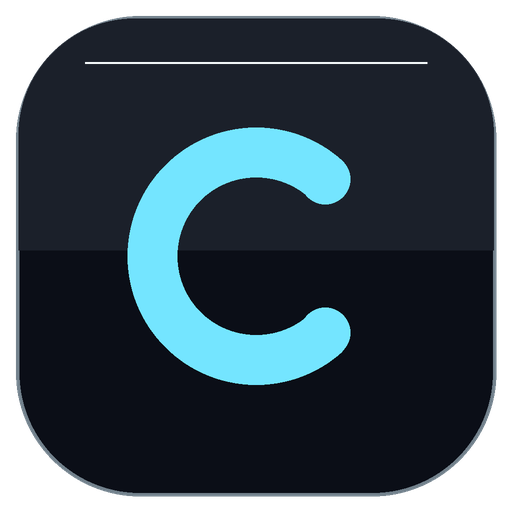

<p align="center">
  
</p>

<h1 align="center">Chips</h1>

<p align="center">
  <b>A desktop TeamSpeak client for Windows. Liquid Glass, light instead of glow, no telemetry.</b>
</p>

<p align="center">
  <a href="LICENSE">MIT</a> ·
  <a href="CHIPS-NOTES.md">Engineering notes &amp; QA</a> ·
  <a href="docs/webspeak3-upstream-readme.md">Upstream WebSpeak3 documentation</a>
</p>

---

## What Chips is

Chips is a self-contained **Windows 10/11 desktop client for TeamSpeak 3, TeamSpeak 6,
TeaSpeak and VoySpeak servers**. It is built from [WebSpeak3](https://github.com/WebSpeak3/webspeak3)
(MIT) and packaged with [Tauri v2](https://tauri.app): the web client runs in the system
WebView2, and the TeamSpeak protocol lives in a Rust process that ships next to the app.

- **No Node.js, no server, no Docker.** The upstream gateway is replaced by a native bridge that
  starts one `ts-connector.exe` sidecar per connection and talks to it over stdin/stdout.
- **The TeamSpeak protocol is untouched.** The connector and [`tsclientlib`](https://github.com/ReSpeak/tsclientlib)
  behave exactly as upstream, so server compatibility is upstream's.
- **No telemetry, no account sync, no design store, no news feed.** Everything the upstream
  web product phones home for is off in the desktop build; the audit is in
  [`CHIPS-NOTES.md`](CHIPS-NOTES.md#no-calls-home-audit-closes-the-open-step-1-item).
- **A visual identity of its own.** Liquid Glass surfaces, a name/avatar effect system where
  *light moves and letters never do*, and no glow anywhere (no bloom, no neon, no orbiting dots).
- **Themes are files, not code.** A `.chipstheme` is one JSON manifest of design-token values —
  no CSS, no scripts, no links. Import and export live in Settings → Appearance, and the
  [theme-making kit](docs/theme-kit/) shows how to build one (or have an AI build one).
- **The server address `wwts.ir:1694` is pre-filled** in the connect dialog. Nothing
  auto-connects: you choose the nickname and press Connect.

Chips connects to any reachable TS3/TS6/TeaSpeak/VoySpeak server; `wwts.ir:1694` is simply the
community server this build is made for.

## Install

1. Download the NSIS installer (`Chips_<version>_x64-setup.exe`) from the **Chips-win-x64**
   artifact of the latest green *Build Chips for Windows* run
   ([Actions](https://github.com/ppourya4-design/chips-client/actions/workflows/build.yml)).
   GitHub serves artifacts as a `.zip`; unpack it first.
2. Run the installer. It adds **Chips** to the Start menu and puts `Chips.exe` together with its
   `ts-connector.exe` sidecar in the install folder (the sidecar must stay beside the app — that
   is how the client reaches your server).
3. Start **Chips**, type a nickname, and connect. The address field already says `wwts.ir:1694`.

Requirements: 64-bit Windows 10 or 11 and the Microsoft Edge **WebView2** runtime (present on
Windows 11 and on virtually every updated Windows 10). If it is missing, the installer fetches
Microsoft's WebView2 bootstrapper from Microsoft's servers — that download is part of the
Microsoft runtime, is the only network access the installer makes, and carries nothing about you
or your server. There is no auto-updater and no background check for new versions.

### The SmartScreen warning (expected)

The installer is **not code-signed**, so the first run typically shows
*"Windows protected your PC — Microsoft Defender SmartScreen prevented an unrecognized app from
starting."* That is what Windows says about any unsigned binary from a small publisher; it is not
a virus report, and it does not mean Defender analysed and cleared the file.

To continue: **More info → Run anyway**. If you would rather verify first, compare the SHA-256 of
the downloaded installer with the one in your Actions run's artifact, and remember that only the
build produced by this repository's workflow is the real thing. Code signing needs a commercial
certificate; until then, this dialog cannot be avoided.

### Staying on a known build

Each Windows build is produced by the checked-in workflow
[`.github/workflows/build.yml`](.github/workflows/build.yml) with pinned Node (`22.22.3`), Rust
(`1.93.1`) and locked dependencies, and the same source tree that is in this repository. The
installer has no update channel.

## Profile style sync

Chips lets you give yourself a name effect, an avatar ring, and a profile card (banner, card
colours, custom status). Part of that is stored locally, part travels with you to other people —
through **your ordinary TeamSpeak client description**.

### The token

When you change your style in **✨ Profile style** (menu bar) or from the profile editor, Chips
writes a compact, versioned token into your client description:

```text
I'm usually in the AFK channel. [s:v1;fx=shimmer;c1=74e5ff;c2=a74cfd;ring=electric;talk=1;bg=74e5ff,a74cfd;dir=135;card=172334,26354a;st=On%20the%20road]
```

| Field | Meaning | Syncs |
|---|---|---|
| `fx` | name effect: `solid`, `shimmer`, `crystal`, `prism`, `talking` | yes |
| `c1`, `c2` | name colours, six-digit hex without `#` | yes |
| `ring` | avatar ring: `gradient`, `speaking`, `electric` | yes |
| `talk` | talking-reactive on/off (`1`/`0`) | yes |
| `bg` | 2–3 banner gradient stops | yes |
| `dir` | banner gradient direction, degrees | yes |
| `card` | two card colours | yes |
| `st` | custom status line, percent-encoded UTF-8, max 80 characters | yes |
| `xp` | XP number — **only if something supplies one**; Chips never invents XP from group names | yes, when present |
| `bi` | custom **banner image** id on the Chips media host (see Media, below) | yes, when present |
| Avatar **image** | local file | **no** |

What this means in practice:

- **What syncs:** name effect and colours, avatar ring, talking-reactive flag, banner gradient,
  card colours, status line, and an XP value if one exists. Anyone running Chips reads the token
  from your description and renders your plate, ring and card with it — and so does *your own*
  client on every other machine.
- **What does not sync:** the uploaded avatar image (it stays in this machine's local
  storage, because a description is a few hundred bytes and images are not); every other
  preference (audio devices, chat logging, theme, language, motion setting, …); and anything
  server-side such as server groups, which come from the server itself. A custom **banner**
  image does sync — see Media below.
- **Nothing else in the description is touched.** Chips replaces the `[s:v1;…]` part in place and
  keeps your own text around it. If you had no token, it appends one.
- **Plain-TeamSpeak clients see the token.** Native TS3 and other clients do not know this format,
  so they show the trailing `[s:v1;…]` as part of your description. That is the price of syncing
  through a field every server already has and every client already replicates.
- **A changed style reaches other Chips clients live**, without reconnecting: the connector reacts
  to the description property change and the UI patches that client in place. (Verified at code
  and event level here; the two-PC check needs two real Windows machines — see the QA table in
  `CHIPS-NOTES.md`.)
- **Permissions still apply.** Writing a description is the server's normal
  `clientedit client_description=…` operation. On a server that refuses it, the write fails and
  the server's error is shown; nothing else in your profile is affected.

Style files: **Export/Import styles.json** in the same editor moves the local style (including
images) as `{ "version": 1, "style": { … } }`.

## Media — chat images, synced banners, nameplates

Chips has a small media host (`https://chips.poyzo.ir`) for the things a
TeamSpeak description cannot carry:

- **Chat images.** With a media token set, the composer's image button (or
  pasting an image) uploads the picture and sends its URL as the message.
  Chips clients render a whole-message Chips image URL inline; plain
  TeamSpeak clients just see the link. Foreign `[img]` hosts still obey the
  generic "load remote chat images" setting — the Chips host is first-party
  and always renders.
- **Synced banner.** Picking a banner in the profile editor uploads it and
  puts its id in the style token (`bi=…`), so every Chips client shows your
  banner on your profile card. Without a custom banner, the card's backdrop
  is your TeamSpeak avatar.
- **Nameplates.** Channel-tree rows and the bottom self-bar show the same
  banner (or the TS avatar) behind the name at low opacity under a dark
  veil. Animated banners play unless avatar animation is off, which freezes
  them on their first frame.

**The token.** Uploads need the shared media token. It is injected at build
time from the `CHIPS_UPLOAD_TOKEN` secret when present; anyone can instead
paste their own under **Settings → Connection → Media token**, which wins
over the build-time one. With no token, upload controls simply hide —
viewing keeps working, because image ids are unguessable links. The token
is never committed to this repository.

## Building from source

Prerequisites: Node **22.22.3**, Rust stable (**1.93.1** is what CI uses) with the MSVC toolchain,
CMake and the Visual Studio C++ workload (Opus is built from source), and the git submodules.

```powershell
git clone --recurse-submodules https://github.com/ppourya4-design/chips-client.git
cd chips-client
npm ci --prefix web
cd connector
cargo build --release --locked --target x86_64-pc-windows-msvc
cd ..\web
New-Item -ItemType Directory -Force src-tauri\binaries | Out-Null
Copy-Item ..\connector\target\x86_64-pc-windows-msvc\release\ts-connector.exe src-tauri\binaries\ts-connector-x86_64-pc-windows-msvc.exe
npx tauri build --target x86_64-pc-windows-msvc --bundles nsis
```

The installer lands in `web/src-tauri/target/x86_64-pc-windows-msvc/release/bundle/nsis/`.
`CMAKE_POLICY_VERSION_MINIMUM=3.5` is needed with newer CMake releases; CI sets it.

**How the parts fit together:**

```text
Chips.exe (Tauri, Rust)
  WebView2  ──  web UI (React, the upstream WebSpeak3 client)
      │  invoke(): start_connector / write_connector / stop_connector
      └──────────────► ts-connector.exe (unchanged Rust sidecar, one per connection)
                            └── tsclientlib ──► your TeamSpeak server
```

The webview cannot choose a binary, pass flags or spawn anything else; the three native commands
validate their input, and the CSP allows no network origin except the bundle itself and Tauri IPC.

The optional **web** deployment (gateway + browser, Docker) still works from this tree — the
upstream instructions, environment variables and limitations are preserved in
[`docs/webspeak3-upstream-readme.md`](docs/webspeak3-upstream-readme.md).

## Documentation

| Document | Contents |
|---|---|
| [`CHIPS-NOTES.md`](CHIPS-NOTES.md) | Recon, the Liquid Glass design system, the animation law, the profile/description-token design, the no-calls-home audit, and the Step 5 QA report. |
| [`docs/webspeak3-upstream-readme.md`](docs/webspeak3-upstream-readme.md) | Upstream WebSpeak3 README: web/Docker deployment, gateway environment variables, browser support. |
| [`docs/theme-kit/`](docs/theme-kit/) | The `.chipstheme` theme-making kit: `starter.chipstheme`, the Persian `tutorial.md`, an English `token-reference.md` and a ready-to-paste `ai-prompt.md`. |
| [`docs/teaspeak.md`](docs/teaspeak.md) | TeaSpeak compatibility notes (upstream). |
| [`ROADMAP.md`](ROADMAP.md) | Upstream product roadmap. |

## Status and known limits

This is a **release candidate**, not a signed store app:

- The Windows installer is unsigned (see SmartScreen above).
- Everything in `CHIPS-NOTES.md` was written from source review plus the Windows CI build; voice,
  device handling and the live two-client style sync still need one run on real Windows machines.
  The QA table marks what was proven here and what was not.
- Screen streaming is upstream's alpha feature and is expected to be unstable; it is the only
  feature that contacts a STUN server, and only when you start a stream.
- Interface text is English and left-to-right. User content (nicknames, chat, status) renders in
  its own direction, so Persian and Arabic read correctly inside the English layout.

## Licence and attribution

Chips is **MIT** licensed — see [`LICENSE`](LICENSE).

It is built on the MIT-licensed [**WebSpeak3**](https://github.com/WebSpeak3/webspeak3) browser
client by Moepchi and contributors: the client UI, the gateway, and the Rust connector all come
from that project, and large parts of `web/` are still upstream code. Chips adds the Tauri host,
the native bridge, the visual design, the animation system and the profile style token format.
Upstream's MIT copyright notice is kept in `LICENSE` and must stay there in redistributions.

Further components:

- [`tsclientlib`](https://github.com/ReSpeak/tsclientlib) (Moepchi/ReSpeak fork) — MIT/Apache-2.0;
  its licence files are bundled with the app.
- Tauri, React, Vite, and the bundled fonts **Plus Jakarta Sans**, **Vazirmatn**, **Manrope** and
  **VT323**, all under the SIL Open Font License; their licence files sit next to the font files in
  `web/src/assets/fonts`.

If you fork or redistribute Chips, keep the WebSpeak3 attribution and the MIT notice.
